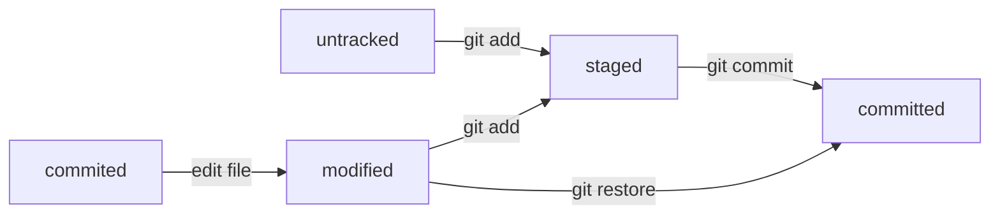

# Шпаргалка

## Навигация
- *pwd* - показать рабочую папку
- *ls* - отобразить содержимое директории
- *ls -a* - покажи также скрытые файлы и папки, названия которых начинаются с символа .
- *cd first-project* - сменить директорию и перейти в папку first-project
- *cd first-project/html* - перейди в папку html, которая находится в папке first-project
- *cd ..* - перейди на уровень выше, в родительскую папку
- *cd \~* - перейди в домашнюю директорию (/Users/Username)
- *cd /* - перейди в корневую директорию

## Работа с файлами и папками
- *touch index.html* - создай файл index.html в текущей папке
- *touch index.html style.css script.js* - если нужно создать сразу несколько файлов, можно напечатать их имена в одну строку через пробел
- *mkdir second-project* - создай папку с именем second-project в текущей папке
- *cp file.txt ~/my-dir* - скопируй файл в другое место
- *mv file.txt ~/my-dir* - перемести файл или папку в другое место
- *cat file.txt* - распечатай содержимое текстового файла file.txt
- *rm about.html* - удали файл about.html
- *rmdir images* - удали папку images
- *rm -r second-project* - удали папку second-project и всё, что она содержит

# Хеш
Git преобразует информацию о коммитах с помощью алгоритма SHA-1 и для каждого из них рассчитывает уникальный идентификатор — хеш.
Хеш — основной идентификатор коммита и позволяет узнать его автора, дату и содержимое закоммиченных файлов.
Все хеши, а также таблицу соответствий хеш → информация о коммите Git хранит в папке .git

# Git log
Можно вызвать не только полный лог, но и сокращённый — это делается командой git log --oneline.
В сокращённом логе выводятся сокращённые хеши — их можно использовать точно так же, как и полные.

# HEAD
В числе прочих файлов в папке .git есть служебный файл HEAD. Он указывает на самый свежий коммит.
Вместо хеша последнего коммита можно написать слово HEAD — Git вас поймёт.

# Статусы файлов

 
# Правила сообщений коммитов
Для сообщений на русском языке часто рекомендуют использовать инфинитивы. Например: Добавить тесты для PipkaService, Исправить ошибку #123 и так далее.
Для сообщений на английском рекомендуется использовать повелительное наклонение (англ. imperative). Например: Use library mega_lib_300, Fix exit button и так далее.
